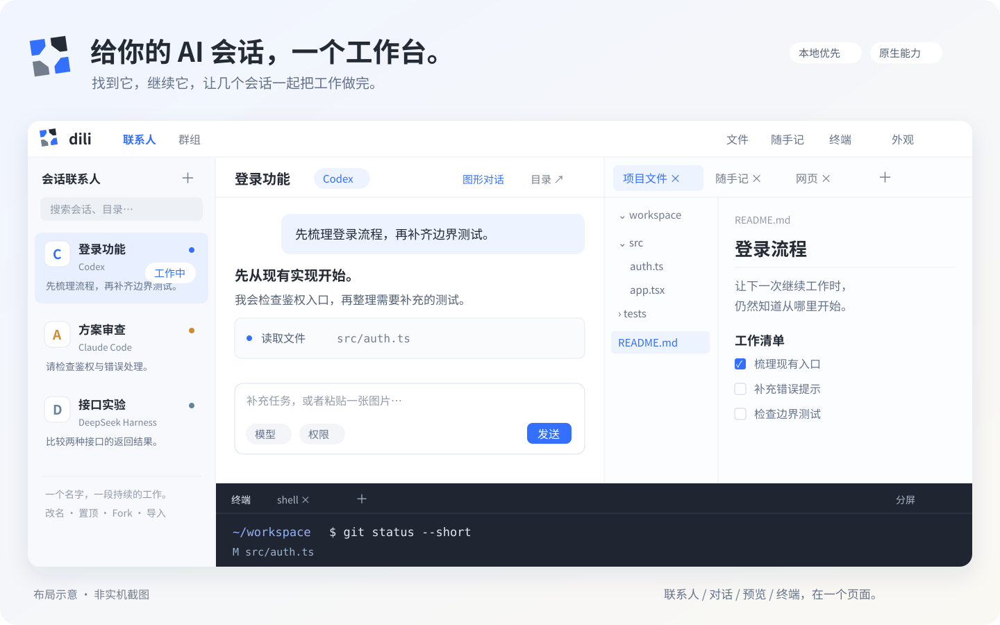

<div align="center">
  
  <h1>给你的 AI 会话，一个工作台。</h1>
  <p><strong>像管理联系人一样，管理 Claude Code、Codex 和 DeepSeek Harness 会话。</strong></p>
  <p>看状态 · 继续对话 · Fork 新思路 · 组织协作 · 手机接续</p>
  <p>
    <a href="#快速开始">快速开始</a> ·
    <a href="docs/installation.md">安装指南</a> ·
    <a href="docs/README.md">文档</a> ·
    <a href="TODO.md">路线图</a> ·
    <a href="https://github.com/xiaoqiang-cheng/dili/issues">反馈</a>
  </p>
  <p><code>本地优先</code> <code>Web 工作台</code> <code>复用原生 Agent</code> <code>开发预览版</code></p>
</div>



<p align="center"><sub>布局示意，非实机截图。让每一次 AI 对话，都能继续成为工作。</sub></p>

## 不用再猜，那个会话在哪个窗口里

一个 Codex 在写功能，一个 Claude 在审查方案，还有一个 Harness 在做实验。Dili 把这些具体会话变成能命名、能找到、能继续的联系人：扫一眼知道谁在工作、谁在等你，点进去接着聊。

你的 Agent 仍使用自己的账号、工具、权限和原生历史。Dili 负责把它们组织成一个日常工作空间。

## 一个页面，把工作接起来

| 你要做的事 | Dili 提供的入口 |
| --- | --- |
| **找回正在做的工作** | 紧凑联系人列表，显示状态、未读提醒和最近用户输入；支持置顶、搜索、改名、目录复制和原生历史导入。 |
| **专心把一轮对话聊完** | 流式 Markdown、代码高亮、可放大 Mermaid、图片输入、对话目录；Codex / Claude 支持图形审批、提问回答和模型／权限设置。 |
| **查看文件，不打断对话** | 右侧统一预览面板：文件树与文件／Git diff 并排，随手记、多个网页通过标签切换；目录可收起，面板可拖动。 |
| **随手验证一下** | 底部是真正的交互式 Shell，支持多终端、分屏和补全；也保留每个 Agent 的原生终端入口。 |
| **试另一条思路** | 原生 Fork 创建独立会话并保留来源；跨工具交接可创建目标联系人、复制近期上下文，由你确认后发送。 |
| **让几个会话协作** | 建立共同目标，选择成员投递任务，单独私聊纠正，再把结果共享回群组。 |
| **离开电脑，也能接着看** | 自建可信中继，输入邀请码生成远程链接；手机登录后继续同一台主机上的工作。 |

六种外观主题、跟随系统、100%–200% 界面缩放。随手记支持即时 Markdown 编辑与自动保存，关闭面板也不会删除内容。

## 从一个联系人，到一组工作伙伴

1. **创建或导入**一个会话，给它起个能认出来的名字，比如「登录功能」或「方案审查」。
2. **点击继续工作**。图形对话处理日常输入和输出，状态变化通过红点和可静音提示音提醒你。
3. **需要另一个方向时 Fork**。保留原会话，新联系人继续试验；会话分叉不自动创建 Git worktree。
4. **需要协作时建群**。定向分工、纠正、共享结果；消息由你决定交给谁，不默认广播给所有 Agent。

桌面上，联系人、对话和预览并排工作；手机上，从联系人列表进入单会话，再返回列表。切换页面或关闭面板不会停止正在运行的 Agent。

## 快速开始

需要 **Node.js 24+、npm、Git**。当前正式发行目标为 **Linux x86_64 / WSL2 x86_64**；WSL2 的完整实机验收仍在进行。

```sh
git clone https://github.com/xiaoqiang-cheng/dili.git
cd dili
./start.sh
```

打开 **http://127.0.0.1:4317**。脚本会检查环境、安装所需依赖、构建并启动；缺少适用的 `node-pty` 预编译包时，需要本机编译工具。前台运行时按 Ctrl+C 会结束 Dili 及其托管的 Agent / Shell，数据仍保留。

在「连接与能力」中检测你已安装的 Agent，也可使用安装、原生登录和 API 配置引导。只需安装自己要用的平台，完成其账号或 API 配置即可。

**当前为开发预览版，尚未发布到 npm。** 想使用 `dili` 命令，可按[安装指南](docs/installation.md)制作并安装本地 npm 包；Linux 工作台与中继发行包的范围见[发布说明与清单](docs/releasing.md)。

<details>
<summary>已有源码安装？更新前先看这里</summary>

不要在活动实例运行期间替换它的依赖。先备份，在独立终端安排维护后更新；服务重启会结束它托管的进程，原生会话可凭 ID 手动恢复。并行开发要隔离 checkout、端口、数据和前端目录。

操作步骤见[数据备份与恢复](docs/operations.md#数据与备份)和[开发约定](docs/development.md)。仅改文档无需重启。

</details>

## 三个平台，各用所长

| 能力 | Codex | Claude Code | DeepSeek Harness |
| --- | --- | --- | --- |
| 联系人、历史导入、原生恢复 / Fork | 支持 | 支持 | 支持，受原生版本及会话条件限制 |
| 网页输入与流式展示 | app-server 结构化图形对话 | stream-json 结构化图形对话 | dsh-tui 兼容路径；或原生 Web |
| 网页内审批、Agent 提问 | 支持 | 支持 | 仍需原生界面 |
| 统一模型 / 权限设置 | 支持原生已接入选项 | 支持原生已接入选项 | 尚未接入统一面板 |
| 图片输入 | 支持 | 支持 | 取决于 TUI、附件服务与模型，仍需实机验收 |
| 原生交互入口 | 同线程终端连接 | 空闲确认后交接，恢复同一持久会话 | 原生 TUI / Web；Web 仅本机 |

Dili 接入的是 **DeepSeek Harness**，不仅是 DeepSeek 模型。平台协议、版本和能力有差异；目前不承诺所有平台都能完全替代原生终端。详细行为见[产品规格](docs/product-spec.md)，扩展方向见[图形工作台方案](docs/graphical-workbench-architecture.md)。

## 数据在你的主机，选择也在你手里

- **本地优先。** 默认仅监听本机，不默认上传会话或启用云同步；Agent 仍会按其自身配置连接模型服务。
- **接着用你的原生环境。** Dili 复用原生认证、工具和历史，不要求搬进另一套模型账号体系。
- **远程由你掌控。** 邀请码中继需要自己的可信服务器；邀请码用于配对，访问仍需所有者密码。HTTPS 在中继终止，并非端到端加密。
- **备份有明确边界。** 联系人、笔记、群组等保存在本地 SQLite；原生历史、凭据和上传附件需分别备份。详见[备份指南](docs/operations.md#数据与备份)。

当前网页预览使用浏览器直连：远程打开工作台，并不会自动转发主机上的开发服务端口。这是[已记录的下一步](TODO.md#23-网页服务远程预览与端口转发2026-10-23)。

## 接下来，一起打磨什么

图形交互的一致性、远程与手机稳定性、Harness 结构化接入，以及更顺畅的跨工具交接。多机接入、任务中心和 Git worktree 分叉仍在规划，进度以 [TODO](TODO.md) 为准。

欢迎通过 [Issues](https://github.com/xiaoqiang-cheng/dili/issues) 提交具体场景：你用的 Agent 与版本、复现步骤、期望行为。请移除密钥、分享令牌和私人对话内容。

| 继续了解 | 文档 |
| --- | --- |
| 安装、原生配置、自动启动、可选语音输入 | [安装指南](docs/installation.md) |
| 使用、数据备份、恢复和故障处理 | [操作指南](docs/operations.md) |
| 邀请码、域名、中继与管理密码 | [远程访问](docs/remote-access.md) |
| 当前产品约定、架构和开发验证 | [文档索引](docs/README.md) |
| 未完成项与正式发行门槛 | [TODO](TODO.md) · [发布清单](docs/releasing.md) |

<sub>项目许可证仍待确定，当前标记为 UNLICENSED。各 Agent 商标归其所有者，Dili 为独立项目；[图标来源与许可](docs/backend-logos.md)。</sub>
